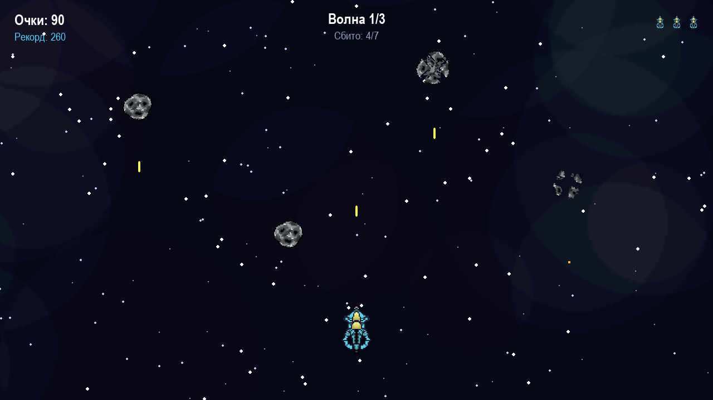
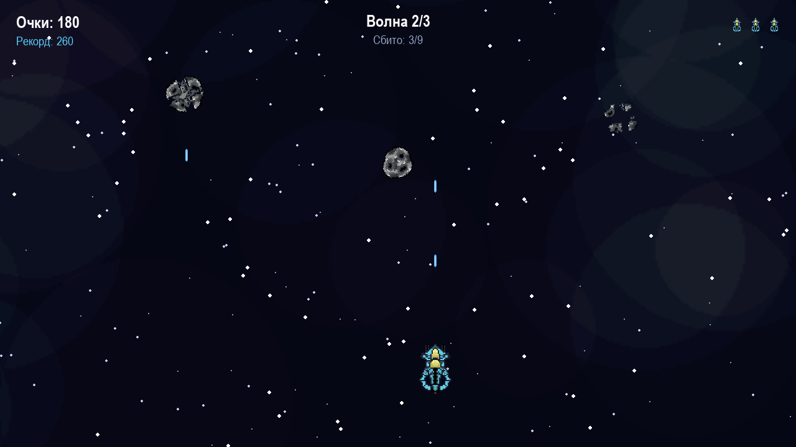
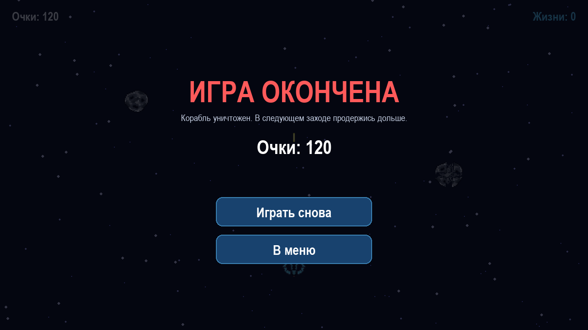
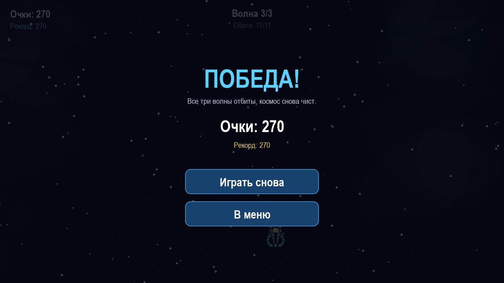

# Space Python — «Космические войны лололошек»

Простая двухмерная космическая аркада на Python и Pygame. Игрок управляет кораблём, отбивает три волны астероидов, набирает очки и старается не столкнуться с камнями.

Проект вырос из учебной заготовки: в нём уже был корабль, летящие астероиды и пули, но не было ни столкновений, ни очков, ни экранов меню. Всё это доработано, а исходные картинки и стиль кода сохранены.


## Возможности

- главное меню с кнопками «Играть» и «Выход»;
- управление кораблём на WASD, ускорение на пробел, стрельба левой кнопкой мыши;
- астероиды выдерживают три попадания и меняют вид: целый → треснутый → обломки;
- три волны с растущей сложностью;
- со второй волны корабль получает новый вид и синие заряды;
- три жизни, после столкновения корабль на две секунды становится неуязвимым и мигает;
- счёт, рекорд в файле `record.txt`, взрывы из частиц, прокручивающийся звёздный фон;
- пауза на Esc, экран победы и экран поражения, перезапуск на R;
- все картинки — из исходного проекта, дорожки к ним собираются от папки с игрой.

## Управление

| Клавиша | Действие |
|---|---|
| `W`, `A`, `S`, `D` | движение корабля |
| `Пробел` | ускорение |
| Левая кнопка мыши | огонь |
| `Esc` | пауза / продолжить, в меню — выход |
| `Q` | из паузы в главное меню |
| `R` или `Enter` | начать заново на экране результата |

## Технологии

- Python 3.10+ (проверено на 3.14);
- Pygame (установлен `pygame-ce` 2.5.8 — современная сборка Pygame, подключается как `import pygame`);
- графика нарисована в Aseprite, исходник `spaceship.aseprite` лежит в корне;
- Git и GitHub для хранения версий.

## Установка и запуск

```bash
# 1. перейти в папку с игрой
cd "games py"

# 2. создать виртуальное окружение (по желанию, но так аккуратнее)
python -m venv venv
venv\Scripts\activate

# 3. установить зависимости
pip install -r requirements.txt

# 4. запустить игру
python main.py
```

Если `pygame` ещё не установлен, достаточно одной команды `pip install pygame-ce`
(или `pip install pygame` — обычная версия тоже подойдёт).

Игру можно запускать из любой папки: пути к картинкам вычисляются от расположения `main.py`.

## Структура проекта

```
main.py                 — вся игра: настройки, ресурсы, логика, отрисовка, главный цикл
assets/
  SpaceShip/            — шесть кадров корабля (покой, полёт, ускорение; два уровня)
  Asteroid/             — три состояния астероида (целый, треснутый, обломки)
  Bull/                 — жёлтый и синий заряды
spaceship.aseprite      — исходник спрайта корабля
record.txt              — рекорд, создаётся автоматически после первой игры
requirements.txt        — зависимости
docs/                   — документация, диаграммы и скриншоты
DEFENSE.md              — материалы к защите простым языком
```

## Документация

| Файл | Содержание |
|---|---|
| [docs/01-project.md](docs/01-project.md) | описание проекта, цель, задачи, актуальность |
| [docs/02-technologies.md](docs/02-technologies.md) | используемые технологии |
| [docs/03-gameplay.md](docs/03-gameplay.md) | правила и игровой процесс |
| [docs/04-code.md](docs/04-code.md) | модули, функции, структуры данных |
| [docs/05-diagrams.md](docs/05-diagrams.md) | диаграмма деятельности, последовательности, структура программы |
| [docs/06-install.md](docs/06-install.md) | установка и запуск |
| [docs/07-testing.md](docs/07-testing.md) | что и как проверялось |
| [DEFENSE.md](DEFENSE.md) | объяснение игры простыми словами, вопросы преподавателя, текст выступления |

## Скриншоты

| Меню | Первая волна |
|---|---|
|  |  |

| Вторая волна | Пауза |
|---|---|
|  |  |

| Поражение | Победа |
|---|---|
|  |  |

## Автор

Учебный проект по программированию на Python.
