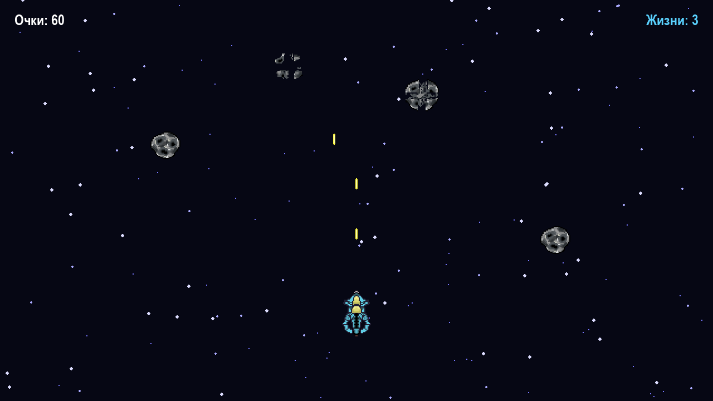
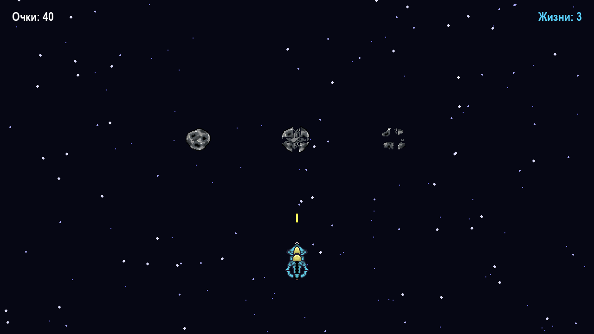
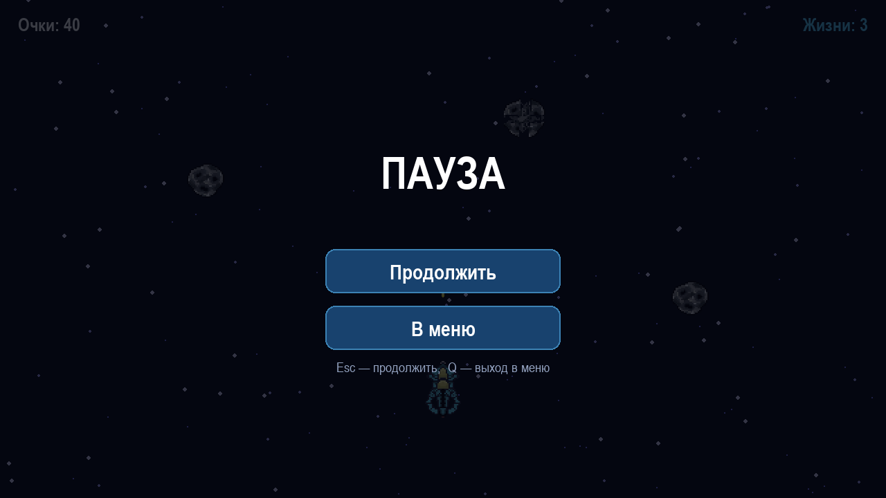

# Space Python — «Космические войны лололошек»

Простая двухмерная космическая аркада на Python и Pygame. Игрок управляет кораблём,
отбивается от бесконечного потока астероидов, набирает очки и старается продержаться дольше.

Проект вырос из учебной заготовки: в нём уже был корабль, летящие астероиды и пули, но не было
ни столкновений, ни очков, ни экранов меню. Всё это доработано, а исходные картинки и стиль
кода сохранены.


## Возможности

- главное меню с одной кнопкой «Играть» (выход из игры по Esc);
- управление кораблём на WASD, ускорение на пробел, стрельба левой кнопкой мыши;
- бесконечный режим: астероиды появляются постоянно, волн и уровней нет;
- у астероида три единицы прочности: три попадания — и он разрушается, за это 10 очков;
- после попаданий астероид меняет вид: целый → треснутый → обломки;
- три жизни, они показаны надписью «Жизни: N»;
- пауза на Esc, экран поражения и перезапуск на R;
- сложность постоянная: скорость астероидов и частота их появления не меняются;
- никаких частиц, искр и вращения астероидов — только простой и понятный код.

## Управление

| Клавиша | Действие |
|---|---|
| `W`, `A`, `S`, `D` | движение корабля |
| `Пробел` | ускорение |
| Левая кнопка мыши | огонь |
| `Esc` | пауза / продолжить, в меню — выход из игры |
| `Q` | из паузы в главное меню |
| `R` или `Enter` | начать заново на экране поражения |

## Технологии

- Python 3.10+ (проверено на 3.14);
- Pygame (установлен `pygame-ce` 2.5.8 — современная сборка Pygame, подключается как `import pygame`);
- графика нарисована в Aseprite, исходник `spaceship.aseprite` лежит в корне;
- Git и GitHub для хранения версий.

## Установка и запуск

```bash
# 1. перейти в папку с игрой
cd "games py"

# 2. создать виртуальное окружение (по желанию, но так аккуратнее)
python -m venv venv
venv\Scripts\activate

# 3. установить зависимости
pip install -r requirements.txt

# 4. запустить игру
python main.py
```

Если `pygame` ещё не установлен, достаточно одной команды `pip install pygame-ce`
(или `pip install pygame` — обычная версия тоже подойдёт).

Игру можно запускать из любой папки: пути к картинкам вычисляются от расположения `main.py`.

## Структура проекта

```
main.py                 — вся игра: настройки, ресурсы, логика, отрисовка, главный цикл
assets/
  SpaceShip/            — кадры корабля (покой, полёт, ускорение и неиспользуемые кадры)
  Asteroid/             — три состояния астероида (целый, треснутый, обломки)
  Bull/                 — жёлтый заряд (используется) и синий (остался от заготовки)
spaceship.aseprite      — исходник спрайта корабля
requirements.txt        — зависимости
docs/                   — документация, диаграммы и скриншоты
DEFENSE.md              — материалы к защите простым языком
```

## Документация

| Файл | Содержание |
|---|---|
| [docs/01-project.md](docs/01-project.md) | описание проекта, цель, задачи, актуальность |
| [docs/02-technologies.md](docs/02-technologies.md) | используемые технологии |
| [docs/03-gameplay.md](docs/03-gameplay.md) | правила и игровой процесс |
| [docs/04-code.md](docs/04-code.md) | функции, переменные, устройство кода |
| [docs/05-diagrams.md](docs/05-diagrams.md) | структура программы, диаграммы деятельности и последовательности |
| [docs/06-install.md](docs/06-install.md) | установка и запуск |
| [docs/07-testing.md](docs/07-testing.md) | что и как проверялось |
| [DEFENSE.md](DEFENSE.md) | объяснение игры простыми словами, вопросы преподавателя, текст выступления |

## Скриншоты

| Меню | Игра |
|---|---|
|  |  |

| Астероид после повреждений | Пауза | Поражение |
|---|---|---|
|  |  |  |

## Автор

Учебный проект по программированию на Python.
