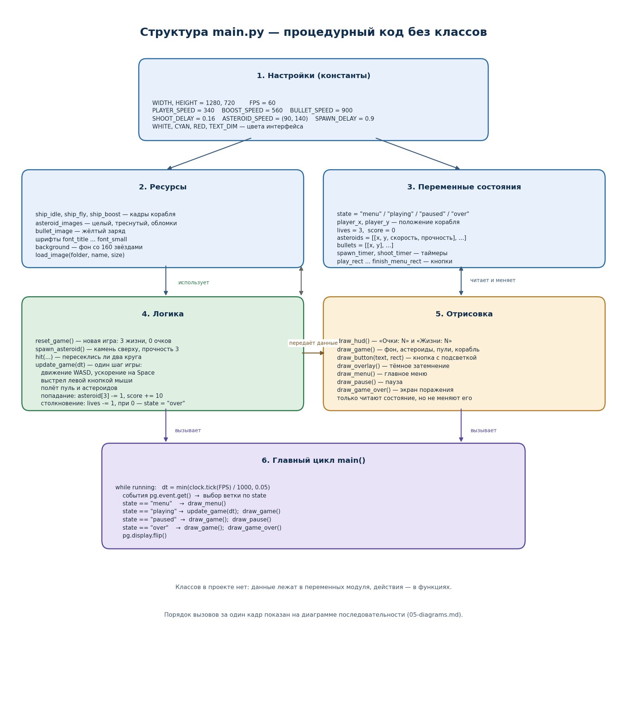

# 5. Диаграммы

Все диаграммы построены по реальному коду `main.py` и отражают только то, что в нём есть.

## 5.1 Про диаграмму классов

**Классов в проекте нет.** Игра написана в процедурном стиле: состояние хранится
в переменных модуля, а поведение — в обычных функциях. Это сделано сознательно:
такой код проще читать и объяснять, а для игры из 388 строк классы не дают пользы.

Поэтому вместо диаграммы классов приведена **схема структуры программы**: она показывает,
из каких частей состоит `main.py`, какие в нём переменные и какие функции к какой части
относятся. Если преподаватель требует именно UML-диаграмму классов, её пришлось бы рисовать
по несуществующим классам, а это было бы неправдой.

## 5.2 Структура программы

Сверху вниз: настройки (константы) → ресурсы (картинки, шрифты, фон) → переменные
состояния → функции логики → функции отрисовки → главный цикл `main()`.
Логика меняет переменные состояния, отрисовка их только читает, а главный цикл вызывает
и то, и другое 60 раз в секунду.

## 5.3 Диаграмма деятельности

Показывает путь игрока: запуск → меню → `reset_game()` → игровой цикл.
Внутри цикла каждый кадр: прочитать ввод → подвинуть корабль → выстрелить → подвинуть пули
и астероиды → проверить попадания → проверить столкновение с кораблём → нарисовать кадр.

Из цикла есть три выхода:

- `Esc` → пауза → продолжить или выйти в меню;
- закончились жизни → экран поражения;
- закрытие окна.

С экрана поражения можно начать заново (`reset_game()`) или вернуться в меню.
Победного экрана нет: режим бесконечный, игра идёт до последней жизни.

## 5.4 Диаграмма последовательности

Один кадр игры: игрок нажимает клавиши и кнопку мыши → `main()` забирает события
и вызывает `update_game(dt)` → двигаются корабль, пули и астероиды, функция `hit()`
проверяет попадание пули и столкновение с кораблём → при третьем попадании прочность
становится нулевой, астероид удаляется и начисляются 10 очков → при столкновении
снимается жизнь, и на нуле жизней `state` становится `over` → `main()` вызывает
`draw_game()` и `pg.display.flip()` показывает кадр.

## 5.5 Как диаграммы связаны с кодом

| Элемент диаграммы | Место в коде |
|---|---|
| Главное меню | `draw_menu()` и ветка `state == "menu"` в `main()` |
| `reset_game()` | функция `reset_game()` |
| Игровой цикл | тело `main()` |
| Движение корабля и ускорение | начало `update_game(dt)`, `BOOST_SPEED` |
| Выстрел | блок стрельбы в `update_game(dt)` |
| Появление астероидов | `spawn_asteroid()` и таймер `spawn_timer` |
| Попадание и прочность | `hit()` и `asteroid[3] -= 1` |
| Очки | `score += 10` |
| Потеря жизни | блок столкновения с кораблём в `update_game(dt)` |
| Экран поражения | `state = "over"` → `draw_game_over()` |
| Пауза | ветка `state == "paused"` в `main()` и `draw_pause()` |
