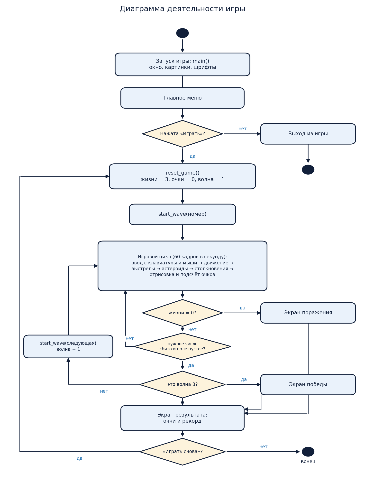

# 5. Диаграммы

Все диаграммы построены по реальному коду `main.py` и отражают только то, что в нём есть.

## 5.1 Про диаграмму классов

**Классов в проекте нет.** Игра написана в процедурном стиле: состояние хранится
в переменных модуля, а поведение — в обычных функциях. Это сделано сознательно:
такой код проще читать и объяснять, а для игры из 617 строк классы не дают пользы.

Поэтому вместо диаграммы классов приведена **схема структуры программы**: она показывает,
из каких частей состоит `main.py` и какие функции к какой части относятся.
Если преподаватель требует именно UML-диаграмму классов, её пришлось бы рисовать
по несуществующим классам, а это было бы неправдой.

## 5.2 Структура программы

Слева направо, сверху вниз: константы → ресурсы и состояние → логика, отрисовка и главный
цикл. Логика меняет переменные состояния, отрисовка их только читает, а главный цикл
вызывает и то, и другое 60 раз в секунду.

## 5.3 Диаграмма деятельности

Показывает путь игрока: запуск → меню → `reset_game()` → `start_wave()` → игровой цикл.
Из цикла есть три выхода:

- закончились жизни → экран поражения;
- волна выполнена, но это не третья волна → `start_wave()` со следующей;
- волна выполнена и она третья → экран победы.

Оба финала ведут на экран результата, откуда можно начать заново (`reset_game()`)
или выйти из игры.

## 5.4 Диаграмма последовательности

Один кадр игры: игрок нажимает клавиши → `main()` забирает события и вызывает
`update_playing(dt)` → обновляются корабль, пули и астероиды, проверяются
столкновения `circles_hit()`, меняются очки и жизни → `main()` вызывает функции
отрисовки → `pg.display.flip()` показывает кадр.

## 5.5 Как диаграммы связаны с кодом

| Элемент диаграммы | Место в коде |
|---|---|
| Главное меню | `draw_menu()` и ветка `state == "menu"` в `main()` |
| `reset_game()` | функция `reset_game()` |
| `start_wave()` | функция `start_wave(number)` |
| Игровой цикл | тело `main()` |
| Движение, выстрел | начало `update_playing(dt)` |
| Астероиды | `spawn_asteroid()` и цикл в `update_playing()` |
| Столкновения и очки | `circles_hit()` и блок `score += 10` |
| Экран поражения | `finish_game(False)` → `draw_finish(False, ...)` |
| Экран победы | `finish_game(True)` → `draw_finish(True, ...)` |
| Файл рекорда | `load_record()` и `save_record()` |
